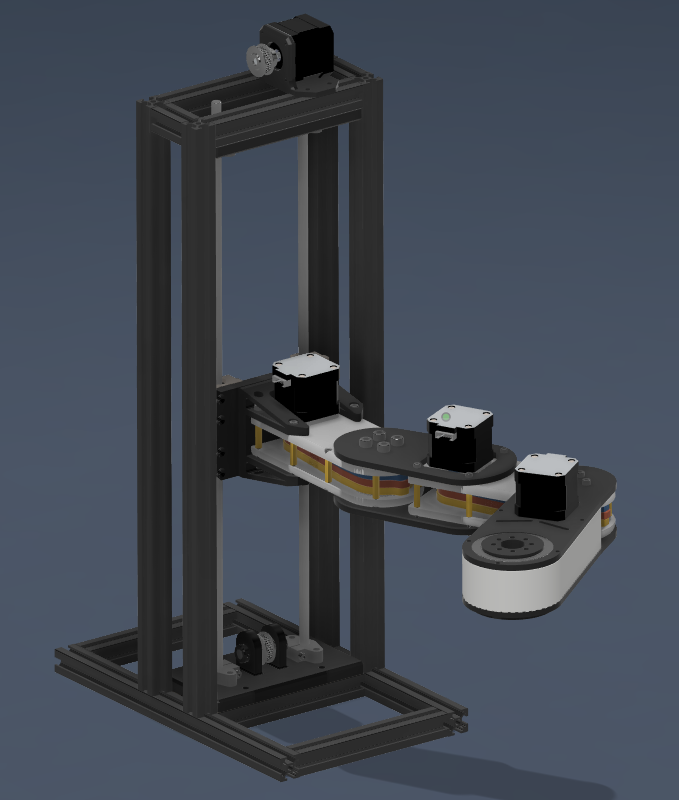
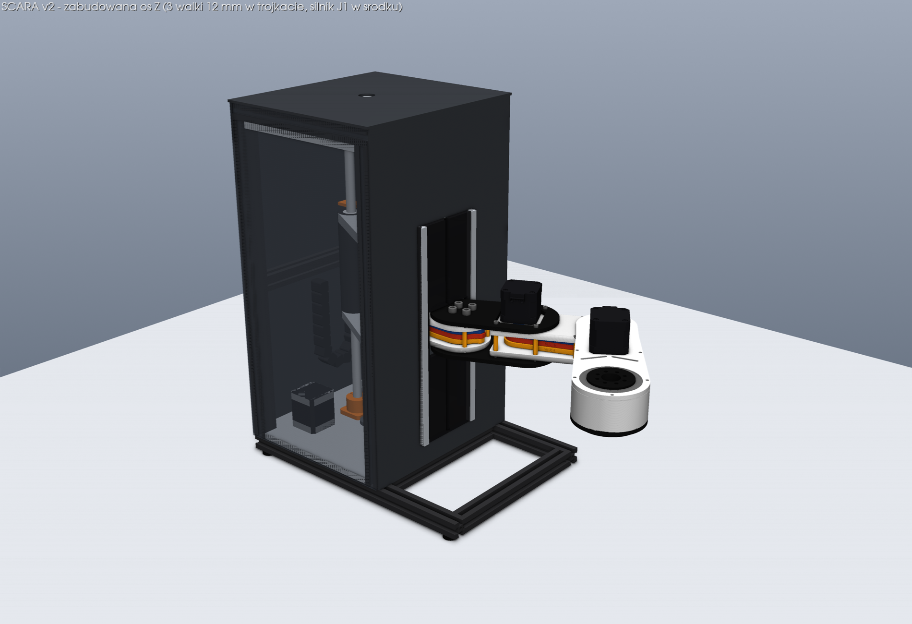

# SCARA

Robot SCARA na profilach aluminiowych 2020, z dwiema przekładniami cykloidalnymi (bark i łokieć), osią Z i obrotowym efektorem. Elektronika: Arduino Mega 2560, 4× TB6600, 4× NEMA 17, gripper SG90.

**Pracuj z gałęzi `main`.** Innych gałęzi nie ma. Zamknięte PR-y #1–#4 są starsze i sprzeczne z tym stanem — opis w [`docs/HISTORY.md`](docs/HISTORY.md).



## Od czego zacząć

| Chcę… | Czytaj |
| --- | --- |
| wiedzieć, co jest zbudowane, a co tylko zaproponowane | [`docs/STATUS.md`](docs/STATUS.md) |
| podłączyć sterowniki | [`docs/WIRING.md`](docs/WIRING.md) |
| sterować robotem z przeglądarki | [`webapp/README.md`](webapp/README.md) |
| wołać firmware z Pythona | [`host/README.md`](host/README.md) |
| liczyć kinematykę / URDF | [`sim/README.md`](sim/README.md) |
| oglądać CAD v1 albo propozycję osi Z v2 | [`cad/README.md`](cad/README.md) |
| kontynuować pracę jako agent | [`AGENTS.md`](AGENTS.md) |

## Mapa katalogów

```text
src/main/     firmware Arduino (config.h + main.ino), SCARA-FW 2.2
webapp/       teach pendant: FastAPI + przeglądarka, jog, punkty, programy
host/         cienki klient szeregowy (pyserial)
sim/          kinematyka, URDF, testy, symulacja PyBullet
cad/v1/       model Fusion, który jest w CAD (STEP + rendery)
cad/v2/       propozycja nowej osi Z — nie jest zbudowana i nie jest we firmware
docs/         stan projektu, okablowanie, historia wrzutów
```

Jedno źródło pinów, przełożeń i limitów programowych: [`src/main/config.h`](src/main/config.h). Reszta ma się z nim zgadzać. Wyjątkiem są wymiary ramion i napęd osi Z — CAD i firmware się tu różnią, a rozstrzygnięcie jest w [`docs/STATUS.md`](docs/STATUS.md). Nie poprawiaj jednej liczby tak, żeby „pasowała” do drugiej, bez pomiaru.

## Uruchomienie

Firmware: Arduino IDE albo `arduino-cli`, płytka **Arduino Mega 2560**, biblioteka **AccelStepper**, szkic [`src/main/main.ino`](src/main/main.ino), 115200 baud. Łokieć da się wyłączyć przez `ELBOW_PRESENT` w `config.h` (nie w `main.ino`).

```bash
# panel webowy (port "sim" = bez robota)
cd webapp && python3 -m venv .venv && . .venv/bin/activate
pip install -r requirements.txt
uvicorn backend.main:app --host 127.0.0.1 --port 8000

# testy
cd webapp && python3 -m pytest tests/ -q
cd sim    && python3 -m pytest -q
cd cad/v2 && python3 -m pytest -q          # bez CadQuery; model 3D wymaga paczek z cad/v2/requirements.txt
```

Szczegóły protokołu (`PING`, `MOVE`, `JOG`, `SETHOME`, `GRIP`) są w [`host/README.md`](host/README.md).

## Stan w jednym akapicie

CAD v1 (czerwiec 2026) ma ramę 2020, oś Z na dwóch wałkach 8 mm i pasku GT2 oraz ramię z dwiema przekładniami cykloidalnymi. Firmware 2.2 umie jechać po kinematyce odwrotnej, homować (albo przyjąć pozycję ręcznie przez `SETHOME`) i gada z panelem webowym. Oś Z v2 — trzy wałki 12 mm w trójkącie, silnik J1 w środku, śruba T8, zabudowa — jest policzona i wymodelowana w `cad/v2/`, ale nie zastąpiła v1 w kodzie sterującym.


