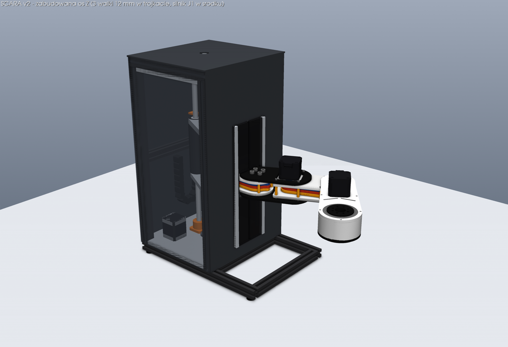
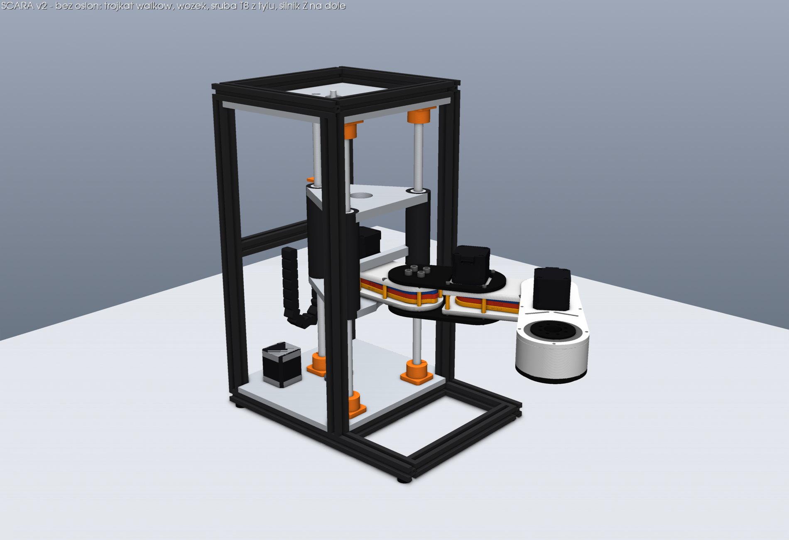
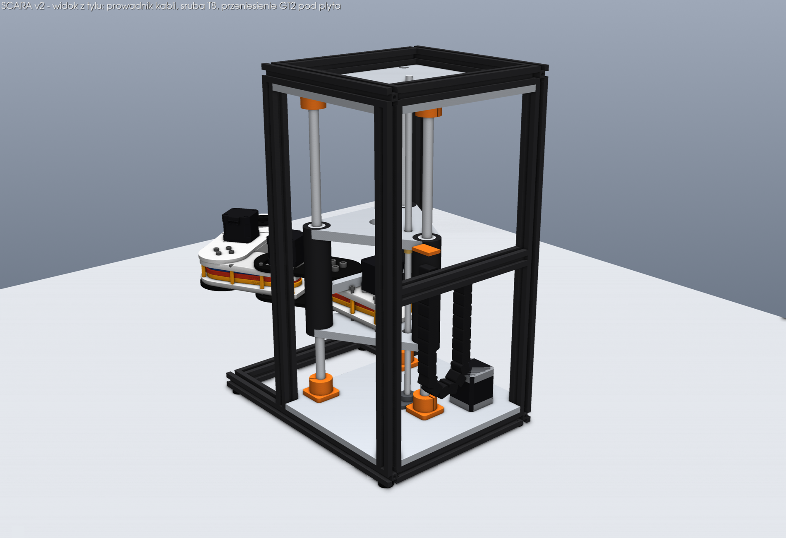
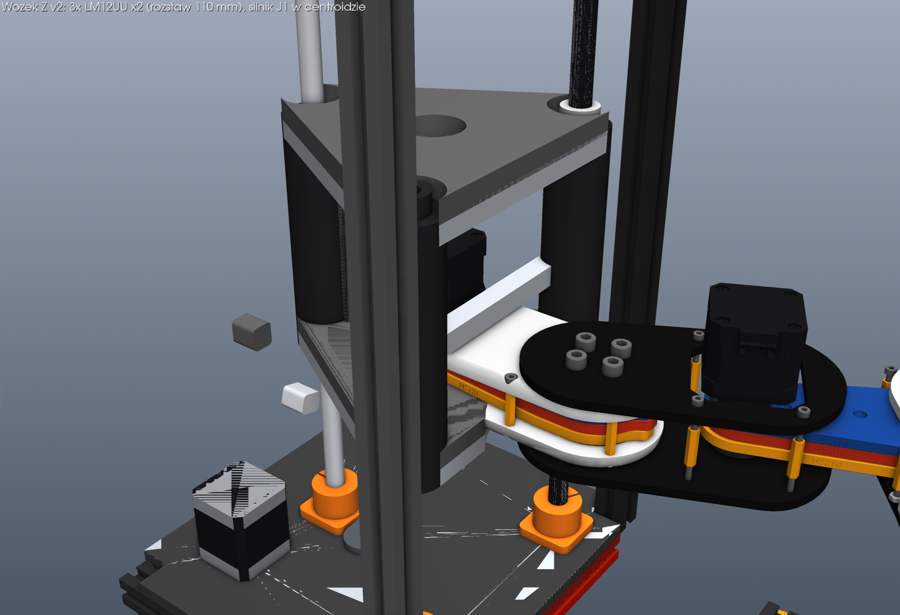
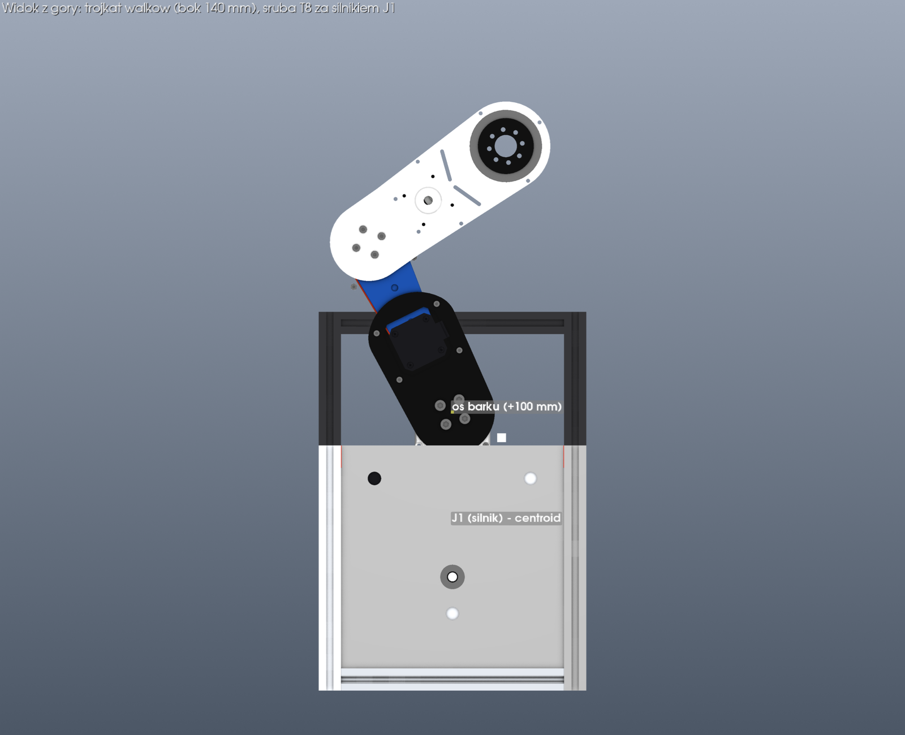
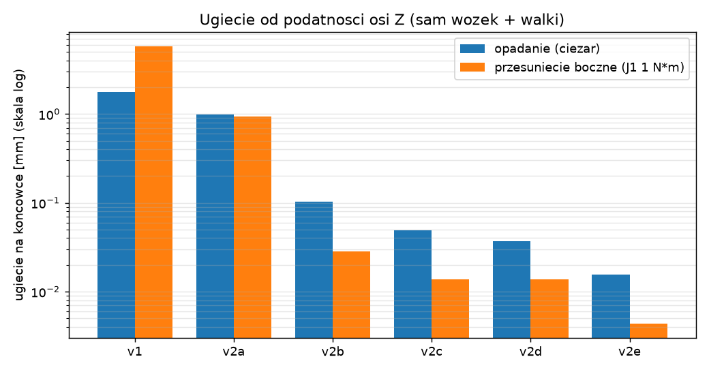
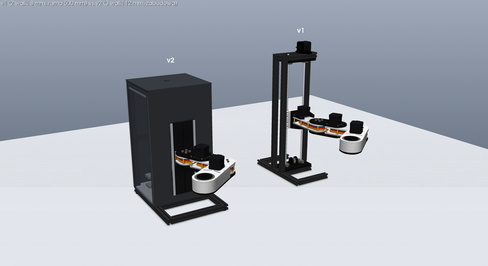

# Os Z v2 - przeprojektowanie (3 walki w trojkacie, silnik J1 w srodku)

Analiza v1 na podstawie `cad/SCARA.step` + propozycja nowej, zabudowanej osi Z.
Ramie i przekladnie cykloidalne zostaja bez zmian (importowane 1:1 z STEP v1),
rama nadal z profili 2020.



## TL;DR

1. Glowny problem v1 to **skret wozka wokol osi pionowej** (reakcja momentu J1)
   i przechyl od ciezaru ramienia. Dwa walki 8 mm o wolnej dlugosci 450 mm
   i tuleje rozstawione tylko o 45 mm w pionie sa po prostu za miekkie.
2. Sam trojkat z 3 walkow (te same walki 8 mm, ta sama dlugosc) daje
   ~5x na skret i ~1.5x na przechyl. **Duzo wiekszy zysk** daja: grubsze walki
   (12 mm), krotsza wolna dlugosc (dopasowana do skoku Z), rozstaw tulei
   >= 100 mm i sztywne zamocowanie koncow walkow. Wszystko razem: ~30x
   na przechyl i ~370x na skret.
3. Przesuniecie silnika J1 do srodka trojkata skraca wysiegnik barku
   ze 161 do 100 mm, ale kosztuje zakres J1: z pelna oslona ok. +/-87 deg
   (v1: +/-125 deg w firmware). Patrz [Kompromis zakresu J1](#kompromis-zakresu-j1).
4. Naped Z: pasek GT2 -> sruba T8 (firmware i tak zaklada 400 krokow/mm,
   czyli T8x8), silnik Z na dole zamiast na szczycie wiezy.

## 1. Diagnoza v1 (zmierzone w STEP)

| Element | v1 | Uwagi |
| --- | --- | --- |
| Walki Z | 2x 8 mm, dl. 500 mm, wolna ~450 mm, SHF8 na koncach | skok Z w firmware: tylko 150 mm |
| Rozstaw walkow | 85 mm (oba w plaszczyznie x=40) | opor na skret = para sil na ramieniu 42.5 mm |
| Tuleje | 2 na walek, srodki 45 mm od siebie | maly rozstaw -> przechyl + luz x10 |
| Wysiegnik | wejscie J1 61 mm przed walkami, os barku 161 mm | caly modul ramienia wisi na `Gearbox Mount` |
| Masa ramienia | ~3.6 kg (z 3 silnikami, PETG ~60% wypelnienia) | srodek ciezkosci ~227 mm przed walkami |
| Moment na wozku | ~8 N*m od samego ramienia, ~10 N*m z 0.5 kg ladunku | |
| Naped Z | pasek GT2, kola 36T, silnik na szczycie (z = 500 mm) | rozciagliwosc paska = podatnosc w Z, wysoki srodek ciezkosci |

Wynik modelu belkowego (`stiffness.py`, wozek w polowie skoku):
v1 opada ~1.8 mm na koncowce od samego ciezaru i przesuwa sie ~5.8 mm bokiem
na kazdy 1 N*m momentu J1. To jest ta "gumowatosc", ktora widac w v1.

### Niespojnosci CAD <-> firmware (warto poprawic niezaleznie od v2)

- **L1 / L2**: w STEP odleglosci osi to **L1 = 170.0 mm** (bark -> lokiec)
  i **L2 = 150.0 mm** (lokiec -> efektor), a `config.h`, `sim/` i `webapp/`
  maja 139.928 / 140.0 mm. Kinematyka odwrotna bedzie sie mylic o
  centymetry. Do potwierdzenia suwmiarka na fizycznym ramieniu.
- **`Z_AXIS_OFFSET_MM = 165`**: 165 mm to glebokosc ramy v1 (y od -165 do 0),
  a odleglosc osi barku od walkow wynosi ~161 mm.
- **`STEPS_PER_MM_Z = 400`** odpowiada srubie T8x8, a w CAD jest pasek GT2
  36T (72 mm/obr -> 44.4 krokow/mm).
- `STEPS_PER_DEG_J2` w `config.h` liczony dla 14:1, a `docs/README.md`
  i komentarze URDF mowia o 20:1.

## 2. Koncepcja v2

| | |
| --- | --- |
|  |  |
|  |  |

- **3 walki 12 mm h6** w trojkacie rownobocznym o boku 140 mm (R = 80.8 mm),
  wierzcholek z tylu, dwa walki z przodu po bokach obudowy przekladni J1.
  Bok 140 mm wynika z dwoch warunkow: obudowa przekladni (68 mm) musi przejsc
  miedzy przednimi wiezami tulei, a sruba Z musi zmiescic sie miedzy silnikiem
  J1 a tylnym walkiem z ~8 mm luzu do obudowy.
- **Silnik J1 dokladnie w centroidzie**, os barku 100 mm przed nim (to stala
  przekladni: wejscie -> wyjscie = 100 mm).
- **Wozek**: dolna plyta Al 10 mm pod `housing-bottom` (z wycieciem R54 na
  obracajacy sie kolnierz wyjsciowy J1), gorna plyta Al 12 mm nad silnikiem J1,
  3 wieze z para LM12UU kazda (rozstaw srodkow 110 mm), belka dociskowa
  12x12 na `housing-top` miedzy przednimi wiezami. Obudowa przekladni jest
  wiec scisnieta z dwoch stron, a nie wisi na jednym wsporniku jak w v1.
- **Wolna dlugosc walka 348 mm** = skok 200 mm + wysokosc wozka 140 mm + luz.
  Walki zaciskane w dlugich oprawach (24 mm, z nacieciem) na plytach Al 8 mm.
- **Naped Z**: jedna sruba T8 w (-48, 0) - za silnikiem J1, przed tylnym
  walkiem - nakretka anty-luzowa pod gorna plyta wozka, lozyska KFL08 gora/dol.
  Silnik Z stoi na dolnej plycie z tylu-z boku, przeniesienie GT2 20T:20T
  (pasek zamkniety ~200 mm) schowane pod dolna plyta, w wysokosci podstawy.
- **Prowadnik kabli** 10x15 w szczelinie za tylnym walkiem (petla U w pionie),
  koniec staly na tylnej poprzeczce w polowie wysokosci.
- **Rama 2020**: 4 slupki 412 mm, gorny wieniec, podstawa wysunieta do przodu
  (x = +190 mm) pod ramie, srodkowa poprzeczka z tylu.

### Zabudowa

- Boki/tyl/gora: dibond (kompozyt Al) 3 mm albo PETG/ABS drukowane panelami,
  przykrecane w rowki 2020 (nakretki mlotkowe). Na renderze prawy bok to
  dymiony PMMA 3 mm (podglad mechaniki).
- Przod: panel z pionowa szczelina 84 mm x ~276 mm (skok + obudowa przekladni)
  i dwie listwy szczotkowe 6 mm zachodzace na siebie - szczotki rozchylaja sie
  na obudowie przekladni, wiec oslona nie wymaga zadnego napedu.
- Gorna pokrywa z przepustem na srube / wentylacje. **Silnik J1 siedzi teraz
  w zamknietej obudowie** - przy 1.5-2 A na TB6600 potrzebne beda szczeliny
  wentylacyjne na gorze i dole albo maly wentylator 40 mm na tylnym panelu.

## 3. Wyniki obliczen

`python3 cad/v2/stiffness.py` (masa ramienia 3.57 kg, ladunek 0.5 kg,
moment J1 1 N*m, wozek w polowie skoku, luz tulei 10 um):

| Wariant | Moment na wozku [N*m] | Przechyl [kN*m/rad] | Skret [kN*m/rad] | Opadanie koncowki [mm] | Skret -> koncowka [mm] | Luz tulei -> koncowka [mm] |
| --- | ---: | ---: | ---: | ---: | ---: | ---: |
| v1: 2x8 mm, L=450, h=45, SHF8, pasek | 10.31 | 2.78 (1x) | 0.08 (1x) | 1.784 | 5.819 | 0.327 |
| v2a: 3x8 mm, L=450, h=45, SHF8 (sam trojkat) | 9.79 | 4.17 (2x) | 0.45 (5x) | 0.986 | 0.936 | 0.239 |
| v2b: 3x10 mm, L=348, h=110, 1 sruba | 9.79 | 40.21 (14x) | 14.77 (179x) | 0.102 | 0.028 | 0.128 |
| **v2c: 3x12 mm, L=348, h=110, 1 sruba (rekomendowany)** | 9.79 | 83.38 (30x) | 30.63 (371x) | 0.049 | 0.014 | 0.128 |
| v2d: 3x12 mm, L=348, h=110, 2 sruby | 7.27 | 83.38 (30x) | 30.63 (371x) | 0.037 | 0.014 | 0.128 |
| v2e: 3x16 mm, L=348, h=110, 1 sruba | 9.79 | 263.53 (95x) | 96.79 (1171x) | 0.016 | 0.004 | 0.128 |



Wnioski z tabeli:

- Moment na wozku prawie sie nie zmienia (10.3 -> 9.8 N*m), bo tuleje nie
  przenosza sil pionowych - ciezar ramienia trzyma naped Z, wiec liczy sie
  odleglosc srodka ciezkosci od **sruby**, nie od walkow. Srodek ciezkosci
  "glebiej" pomaga glownie przez krotsze ramie dzwigni na koncowce, nie
  przez mniejszy moment. Dwie sruby po bokach obudowy (v2d) zmniejszaja moment
  o 25%, ale przy walkach 12 mm daje to tylko 0.012 mm - **nie warto** dla
  komplikacji (synchronizacja, drugi pasek).
- Po v2c podatnosc osi Z przestaje byc waskim gardlem. Nastepne w kolejce:
  luz tulei (~0.13 mm na koncowce przy 10 um), luz i podatnosc przekladni
  cykloidalnych oraz plyty PETG ramienia.

## 4. Rekomendacje (w kolejnosci wplywu)

1. **Walki 12 mm h6 hartowane, wolna dlugosc dopasowana do skoku.** Kazdy
   milimetr ponad potrzebny skok kosztuje sztywnosc (przesuniecie ~L^3).
   Konce zaciskane w plytach Al w otworze o dlugosci >= 2xD, nie w SHF
   przykreconych do druku.
2. **Rozstaw tulei w pionie >= 100 mm.** Wozek 140 mm z para LM12UU na
   walek. Rozstaw dziala na przechyl i na luz (luz -> kat = 2*luz/h).
3. **Przesztywnienie 3 walkow.** 6 tulei na 3 walkach to uklad
   przewymiarowany - minimalna nierownoleglosc walkow = zakleszczanie.
   Wiercic/rozwiercac dolna i gorna plyte ramy **razem w pakiecie** (oraz obie
   plyty wozka razem), a tylna wieze montowac na owalnych otworach (luz
   promieniowy w strone centroidu), dokrecac dopiero po przejechaniu pelnego
   skoku. Alternatywa: tylna wieza na jednej tulei samonastawnej.
4. **Sruba T8 zamiast paska.** T8x8 = obecne 400 krokow/mm, ale nie jest
   samohamowna - po zdjeciu ENA ramie zjedzie w dol. T8x4 (800 krokow/mm)
   jest na granicy samohamownosci, T8x2 na pewno trzyma. Nakretka
   anty-luzowa, sruba ulozyskowana stalo na dole i plywajaco na gorze (albo
   nakretka na plywajacym adapterze), zeby bicie sruby nie szlo w wozek.
5. **Plyty nosne z aluminium** (cieta waterjetem/laserem 6061 lub 5754):
   plyty ramy 8 mm i plyty wozka 10/12 mm. Wieze tulei moga zostac z PETG,
   ale tuleje lepiej trzymac w zacisku (szczelina + sruba) niz na wcisk -
   PETG pelza pod stalym obciazeniem.
6. **Obudowa przekladni J1 scisnieta przez wozek** (dolna plyta + belka na
   gorze), zamiast jednego wspornika z tylu jak `Gearbox Mount` v1.
7. **Silnik Z na dole** - srodek ciezkosci calego robota spada o kilkadziesiat
   mm, a wieza nie ma 350 g na czubku.
8. **Podstawa przykrecona do blatu/plyty.** Ramie 3.6 kg na 400 mm przy
   dynamicznych ruchach potrafi bujac cala wieza na stopkach.
9. Przy nastepnej iteracji ramienia: `housing-top/bottom` i `Axis1_Plate_*`
   z Al 4-6 mm albo przynajmniej Al jako nakladki - to bedzie kolejne waskie
   gardlo po osi Z.

## Kompromis zakresu J1

Silnik J2 i tyl obudowy przekladni J2 leza ~70 mm za osia barku. Gdy bark
jest 100 mm od centroidu (zamiast 161), przy duzych katach J1 modul J2 wchodzi
w kolumne (`python3 cad/v2/z_gantry_v2.py --check`):

| Konfiguracja | Zakres J1 |
| --- | ---: |
| v2, pelny panel przedni ze szczelina | ok. +/-87 deg |
| v2, bez panelu przedniego (szczotki tylko na slupkach) | ok. +/-97 deg |
| v1 (firmware) | +/-125 deg |

Bok trojkata (110-140 mm) zmienia to tylko o kilka stopni. Jesli potrzebny
jest wiekszy zakres, mozliwe opcje: silnik J1 przesuniety ~27 mm przed
centroid (bark ~127 mm -> ~+/-110 deg), albo silnik J2 przeniesiony dalej
na ramieniu (zmiana ramienia).

## 5. Zmiany w oprogramowaniu po przebudowie

- `Z_AXIS_OFFSET_MM` -> 100 mm (bark - os kolumny), strefa wykluczenia
  kolumny jako prostokat zamiast kola R45 (przod obudowy jest 27 mm za osia
  barku, szerokosc +/-123 mm w Y).
- `J1_MIN_DEG/J1_MAX_DEG` -> +/-85 deg (z zapasem).
- `ARM_L1_MM/ARM_L2_MM` -> wartosci z pomiaru (STEP: 170 / 150 mm).
- `STEPS_PER_MM_Z` wg wybranej sruby (T8x8: 400, T8x4: 800, T8x2: 1600).
- URDF w `sim/scara.urdf` i `webapp/backend/kinematics_mm.py` - te same stale.

## 6. Lista materialow osi Z v2 (orientacyjnie)

| Ilosc | Element |
| ---: | --- |
| 3 | walek 12 mm h6 hartowany, L = 396 mm |
| 6 | tuleja LM12UU (lub 3x LM12LUU) |
| 6 | oprawa walka (druk PETG/CNC Al, otwor 24 mm z zaciskiem) |
| 1 | sruba T8 (skok 8/4/2), L ~ 450 mm + nakretka anty-luzowa |
| 2 | lozysko KFL08 |
| 2 | kolo GT2 20T (otwor 5 mm i 8 mm) + pasek zamkniety GT2 ~200 mm |
| 1 | NEMA17 (os Z, istniejacy) |
| 2 | plyta Al 8 mm ~220 x 240 mm (dol, gora) - wyciecia na slupki |
| 1 + 1 | plyty wozka Al 10 mm i 12 mm (trojkat zaokraglony R17) |
| 1 | belka Al 12 x 12 x ~140 mm (docisk obudowy J1) |
| 4 | profil 2020, 412 mm (slupki) |
| 2 | profil 2020, 340 mm (podstawa wzdluz) |
| 6 | profil 2020, 200 mm (poprzeczki podstawy, gory, tyl) |
| 2 | profil 2020, 220 mm (gorny wieniec) |
| 1 | prowadnik kabli 10x15, ~360 mm |
| - | panele 3 mm: 2x 220 x 432, tyl i przod 240 x 432, gora 226 x 246 |
| 2 | listwa szczotkowa 6 mm, ~280 mm |

## Pliki

- `params.py` - wszystkie wymiary v2 (zmiana jednego parametru przebudowuje
  model i obliczenia).
- `stiffness.py` - porownanie sztywnosci (`--plot` zapisuje wykres),
  `test_stiffness.py` - test modelu belkowego vs wzory zamkniete.
- `z_gantry_v2.py` - model CadQuery; eksportuje `z_gantry_v2.step` (sama os Z
  v2, do zaimportowania w Fusion), `--check` raportuje zakres J1.
- `render.py` - rendery do `renders/` (ramie importowane z `../SCARA.step`).

```bash
pip install -r cad/v2/requirements.txt
cd cad/v2
python3 stiffness.py --plot renders/stiffness_comparison.png
python3 z_gantry_v2.py            # -> z_gantry_v2.step
python3 render.py                 # -> renders/*.png  (~2 min)
python3 -m pytest -q test_stiffness.py
```


